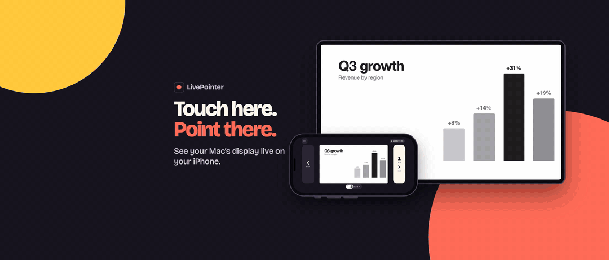
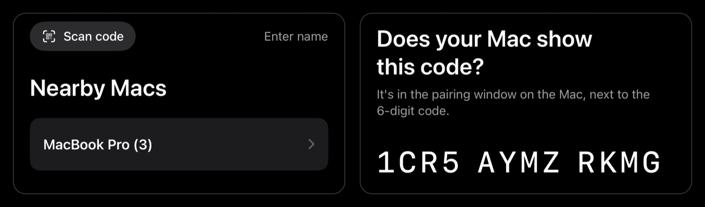

  <picture>
    <source media="(prefers-color-scheme: dark)" srcset="assets/livepointer-wordmark-dark.png">
    
  </picture>

  Your iPhone is the laser pointer. Your Mac draws it on the screen.

  
  
  
  
  

   
  <a href="https://github.com/JH-Eric-Yang/LivePointer/blob/main/assets/livepointer.mp4">Watch the video with sound</a>

Presenting on a TV? A real laser pointer is useless on it. LivePointer draws the pointer straight into the picture: the Mac app paints a dot, a spotlight or an ink stroke on top of whatever is on your display, and the iPhone app, showing a live preview of that display, is the controller. Wherever your finger touches, the pointer appears on the big screen.

This repository is the download page for the Mac app. The iPhone app is on the App Store.

## Install

### Mac

1. Download `LivePointer-<version>.pkg` from the **[latest release](https://github.com/JH-Eric-Yang/LivePointer/releases/latest)**.
2. Open it and click **Install**. LivePointer starts in the menu bar.
3. Allow **Local Network** when macOS asks, so the iPhone can find the Mac.

Prefer to drag and drop? Each release also has `LivePointer-<version>.zip` with the app bundle. Both are signed with an Apple Developer ID and notarized by Apple.

### iPhone

Get **LivePointer** on the App Store. The Mac app shows a code that opens the listing: *Get the iPhone App…* in the menu bar.

## Pair once, then open and go

1. Open LivePointer on the Mac. The pairing window appears on first launch.
2. Open LivePointer on the iPhone. The Mac appears under **Nearby Macs**. Tap it, or scan the code in the pairing window.
3. If the phone asks, check the safety code matches the one in the Mac's window.

Both devices need the same Wi-Fi network or the iPhone's Personal Hotspot. Pairing is remembered.

  

## Features

- **Three pointer styles.** A laser dot, a spotlight that dims everything but a circle, and ink that fades a moment after you draw.
- **Live preview.** The phone shows what the display shows. Touch it, and the pointer lands at the same spot on the TV.
- **Any display, any app.** Pick a display from the phone, or point on all of them. Works over Keynote, PowerPoint, a PDF, a browser, a demo.
- **Slides.** Next and previous, start and end the show, and tap a thumbnail to jump in Keynote and PowerPoint.
- **Hands on the phone, eyes on the room.** Change slides with the volume buttons, the Action Button, Back Tap or Shortcuts.
- **Size and colour.** Pinch to resize, pick a colour that reads on your slides.
- **Private by design.** Phone and Mac talk directly over your network, encrypted. No account, no server, no analytics.

## Requirements

| | |
|---|---|
| Mac | macOS 15 or later, Apple silicon or Intel |
| iPhone | iOS 17 or later |
| Network | Same Wi-Fi, or the iPhone's Personal Hotspot |

## Permissions on the Mac

Each permission is asked for when you first use the feature, and each is optional.

| Permission | What it's for |
|---|---|
| Local Network | Letting the iPhone find the Mac |
| Screen Recording | The live preview on the phone |
| Accessibility | Next and previous slide in apps other than Keynote and PowerPoint |
| Automation | Slide position, thumbnails and jumping in Keynote and PowerPoint |

## FAQ

**Is the Mac app free?**
Yes. The iPhone app is a one-time purchase on the App Store.

**The Mac doesn't show up on the phone.**
Check both devices are on the same Wi-Fi or hotspot, that LivePointer is running on the Mac, and that Local Network is allowed for LivePointer on both the Mac (System Settings) and the iPhone (Settings).

**Why does the phone ask me to check a safety code?**
The phone trusts only your Mac's own certificate. The code lets you confirm it's your Mac the first time, or after the Mac was reset. Pair only if the codes match.

**I renamed my Mac.**
Tap *Choose another Mac* on the phone and pick it again from the list.

**Can I use it from Safari instead of the iPhone app?**
Yes, with a one-time certificate profile. The steps are under *Advanced* in the Mac's pairing window.

**How do I update?**
*Check for Updates…* in the Mac app's menu opens this page. Run the new installer; it replaces the previous version.

## Support

Found a problem? [Open an issue](https://github.com/JH-Eric-Yang/LivePointer/issues) with your macOS and iOS versions and what you expected to happen.

---

  Copyright © 2026 Jiahao Yang. All rights reserved. 
  LivePointer is distributed as a signed and notarized download. The source code is not published here.

